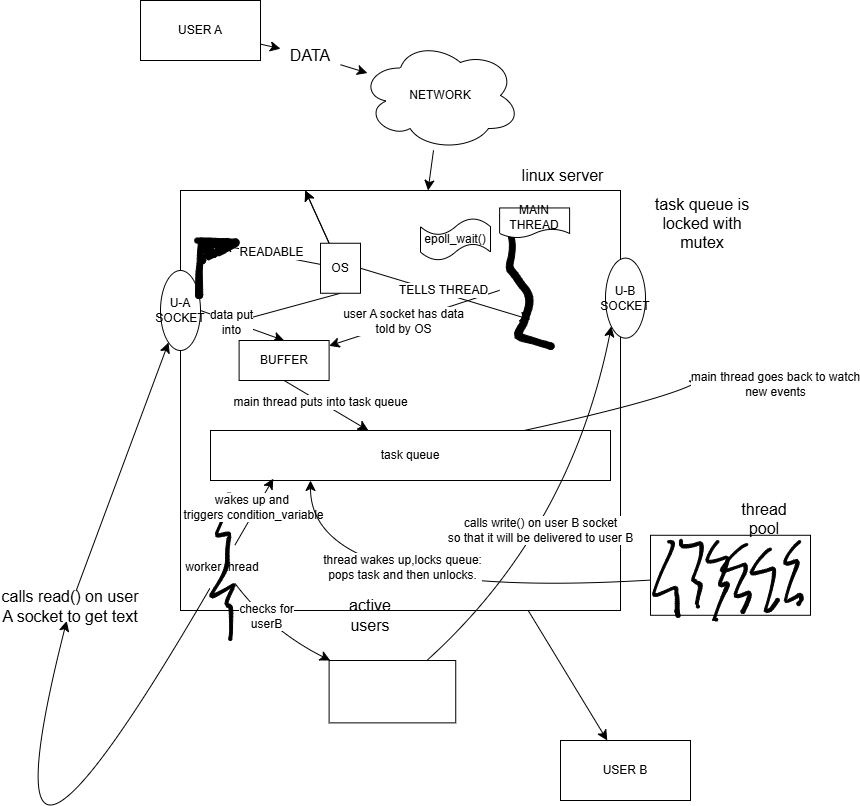
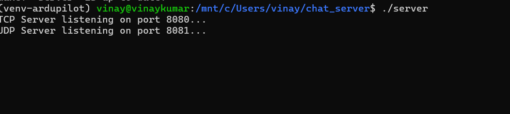
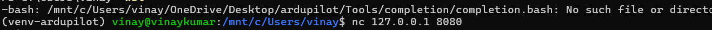
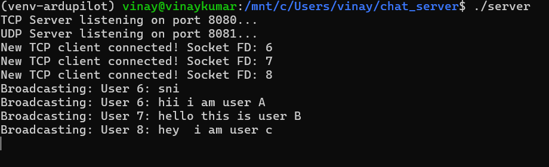

# UDP/TCP Multimedia Chat Server

A high-performance, event-driven networking server written in C++. This architecture utilizes POSIX sockets, a custom thread pool, and Linux `epoll` I/O multiplexing to handle simultaneous connection-oriented (TCP) and connectionless (UDP) traffic without blocking the main execution thread.

## 🧠 Architecture & Notes

### How it works?

user A ———————————————> user B

This is what actually happens underneath understanding with two users.
* created in draw.io



### Let's build task queue now:
* **epoll thread** - pushes incoming network events.
* **worker thread** - pops them off.

---

## 🚀 Core Features
* **I/O Multiplexing:** Uses `epoll` in Edge-Triggered (`EPOLLET`) mode for highly efficient, non-blocking socket monitoring.
* **Thread Pool:** Custom implementation using `std::thread`, `std::mutex`, and `std::condition_variable` to safely distribute network events across worker threads.
* **Dual-Protocol Routing:** 
  * **TCP (Port 8080):** Handles reliable, connection-oriented chat broadcasting.
  * **UDP (Port 8081):** Handles high-speed, connectionless packet drops (simulating multimedia streaming) using `recvfrom` and `sendto`.

## 📁 Project Structure
* `src/main.cpp` - The core event loop, UDP/TCP socket initialization, and `epoll` host.
* `src/task_queue.cpp` - Thread-safe queue protecting memory with mutex locks.
* `src/thread_pool.cpp` - Worker thread lifecycle, connection state management, and network routing logic.

## 🛠️ How to Build and Run
This project requires a Linux environment (or WSL) and a C++17 compatible compiler.

```bash
# 1. Compile the server
make

# 2. Start the server
./server








